<p align="center">
  
</p>

<h1 align="center">Handsfreely</h1>

<p align="center">
  Звонки, контакты и SMS телефона Android на компьютере с Windows по Bluetooth.<br>
  Calls, contacts and SMS of an Android phone on a Windows PC over Bluetooth.
</p>

<p align="center">
  <a href="#русский">Русский</a> | <a href="#english">English</a>
</p>

# Русский

## Что умеет

- Звонить с компьютера и принимать звонки: звук разговора идёт через микрофон и динамики ПК (Bluetooth HFP).
- Звонок идёт в стандартном окне звонка Windows, а панель Handsfreely добавляет фото контакта, микрофон, удержание, тоновый набор и перевод звука на телефон.
- Контакты телефона с поиском и фотографиями, журнал звонков.
- SMS: переписки, ответ, новое сообщение, быстрый ответ прямо из уведомления. SMS идут по стандартному Bluetooth MAP, поэтому приложению на телефоне не нужен доступ к сообщениям и оно ставится без блокировок Play Защиты.
- Ссылки `tel:` в браузере открывают набор номера.
- Сопряжение по QR-коду и шифрование всего канала. Несколько телефонов на одном ПК и несколько ПК у одного телефона; у каждого пользователя Windows свои телефоны.
- Интерфейс на русском и английском.

Работает без интернета и без учётных записей: всё идёт напрямую между телефоном и компьютером.

## Скриншоты

Компьютер:

<p align="center">
  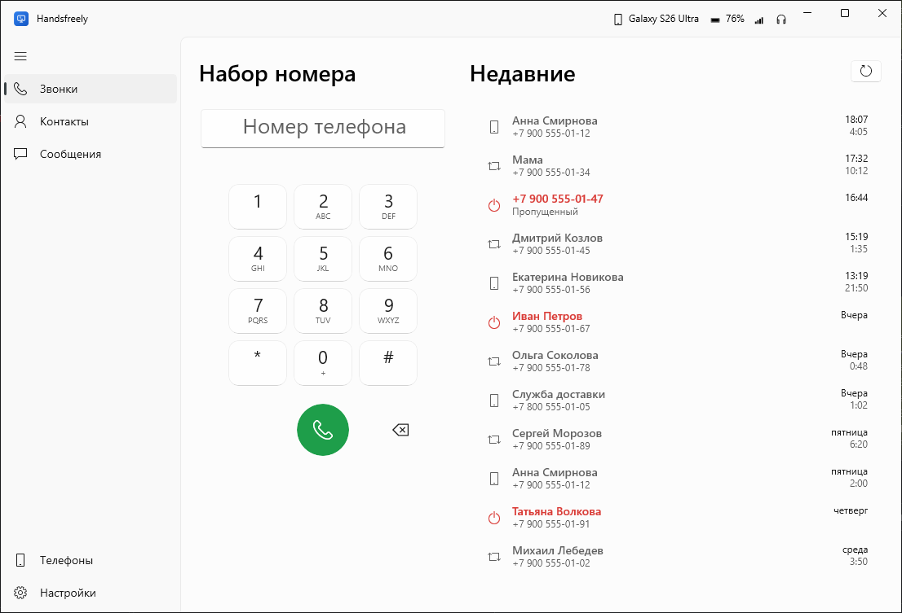
  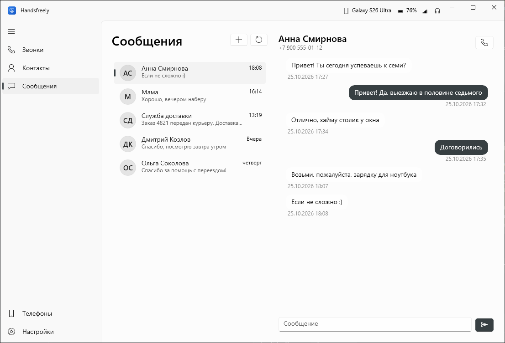
</p>
<p align="center">
  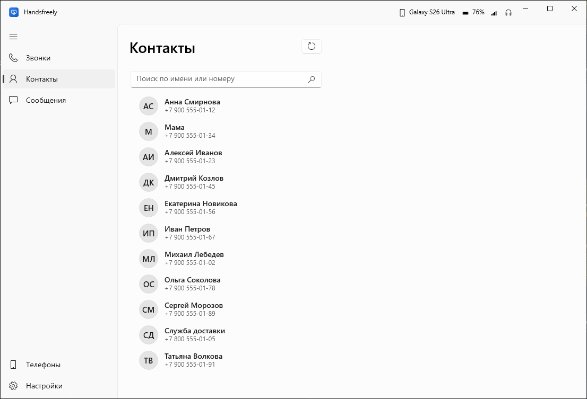
  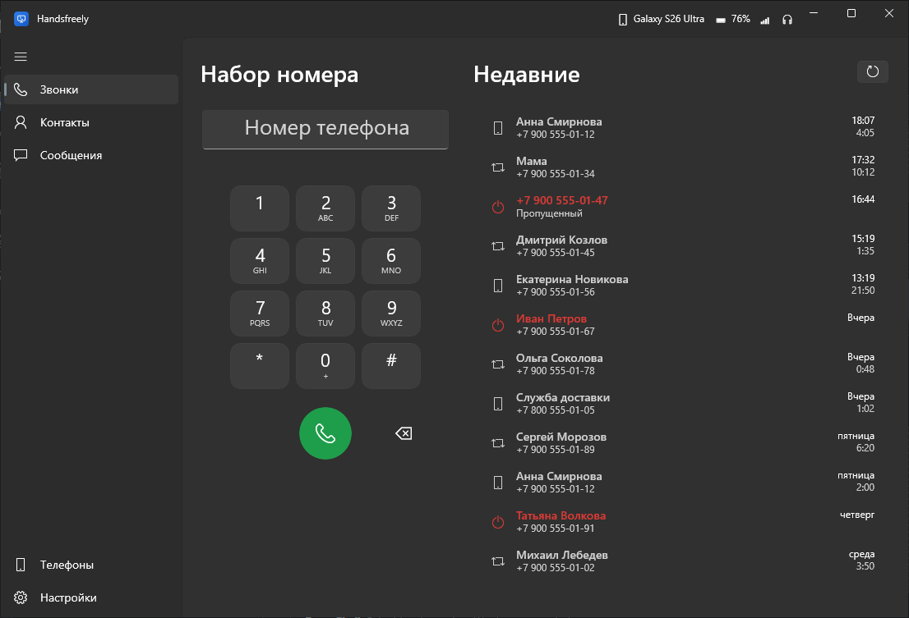
</p>

Телефон:

<p align="center">
  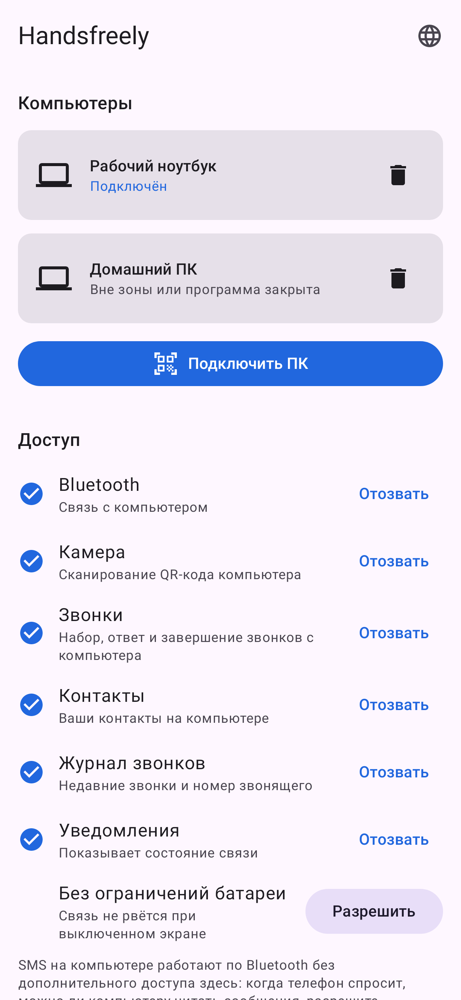
  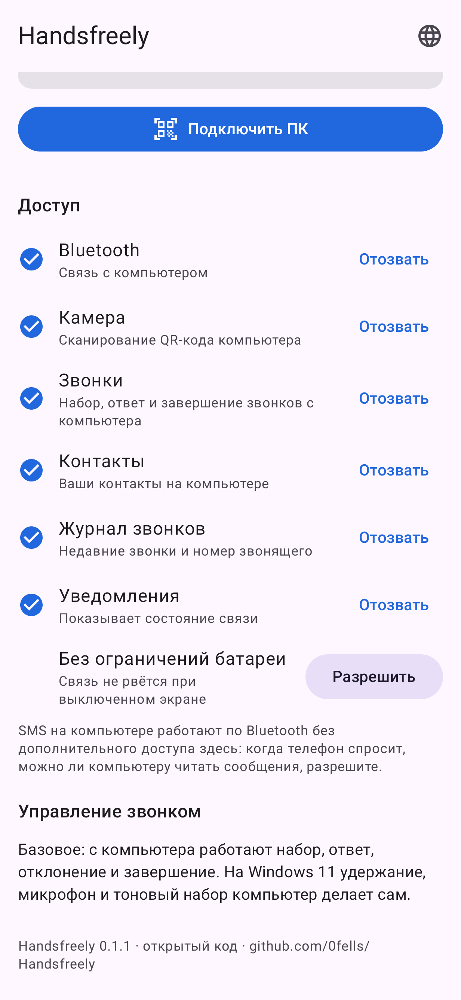
  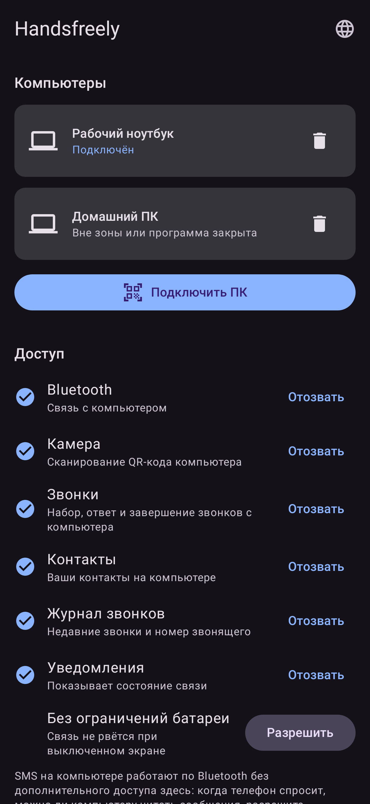
</p>

## Требования

- Windows 10 версии 2004 или новее, либо Windows 11, с Bluetooth.
- Телефон на Android 10 или новее.
- На Windows 10 удержание, тоновый набор и перевод звука на телефон с компьютера недоступны: для них приложению на телефоне нужно полное управление звонком, а Android выдаёт его только системным приложениям. На Windows 11 эти функции выполняет сама Windows.

## Установка

Файлы лежат в [последнем релизе](https://github.com/0fells/Handsfreely/releases/latest).

**Компьютер.** Пакет подписан собственным сертификатом проекта, поэтому Windows нужно один раз ему доверить:

1. Скачайте `Handsfreely.cer` и `Handsfreely-x64.msix`.
2. Установите сертификат одним из способов:
   - Дважды щёлкните `Handsfreely.cer` → "Установить сертификат" → "Локальный компьютер" → "Поместить все сертификаты в следующее хранилище" → "Обзор" → "Доверенные лица" → "Готово".
   - Или откройте PowerShell от имени администратора и выполните (если файл скачан не в "Загрузки", поправьте путь):
     ```
     Import-Certificate -FilePath "$env:USERPROFILE\Downloads\Handsfreely.cer" -CertStoreLocation Cert:\LocalMachine\TrustedPeople
     ```
3. Откройте `Handsfreely-x64.msix` и нажмите "Установить".

**Телефон.** Скачайте `Handsfreely.apk` на телефон, откройте его и разрешите установку из этого источника.

## Обновление

Скачайте файлы нового релиза и откройте их так же, как при установке: `Handsfreely-x64.msix` на компьютере (кнопка "Обновить") и `Handsfreely.apk` на телефоне. Новая версия встанет поверх старой, сопряжение и настройки сохранятся. Сертификат второй раз ставить не нужно.

## Удаление

- **Компьютер.** Пуск → правой кнопкой по Handsfreely → "Удалить" (или "Параметры" → "Приложения"). Вместе с программой удаляются её настройки и сопряжение с телефонами. Сертификат остаётся; убрать его можно в PowerShell от имени администратора:
  ```
  Get-ChildItem Cert:\LocalMachine\TrustedPeople | Where-Object Subject -eq "CN=Handsfreely" | Remove-Item
  ```
  Bluetooth-сопряжение телефона с компьютером удаляется отдельно, в параметрах Bluetooth Windows.
- **Телефон.** Удерживайте значок Handsfreely → "Удалить" (или "Настройки" → "Приложения" → Handsfreely → "Удалить"). Все выданные доступы снимаются вместе с приложением.

## Как подключить

1. Сопрягите телефон с компьютером в параметрах Bluetooth Windows.
2. Установите Handsfreely на компьютер и на телефон (см. "Установка").
3. На компьютере откройте "Телефоны" и нажмите "Добавить телефон".
4. На телефоне нажмите "Подключить ПК" и отсканируйте QR-код.
5. Разрешите в приложении на телефоне доступ к звонкам, контактам и журналу: что не разрешите, то не будет видно на ПК. Там же любой доступ можно отозвать.
6. Когда телефон спросит, можно ли компьютеру получить доступ к сообщениям, разрешите: так работают SMS.

## Как это устроено

Звук разговора переносит стандартный профиль Bluetooth HFP: компьютер становится гарнитурой телефона. SMS компьютер читает и отправляет сам по стандартному профилю Bluetooth MAP. Контакты, журнал и управление звонком идут по отдельному каналу RFCOMM между программой на ПК и приложением на телефоне. Канал зашифрован (ECDH P-256, AES-256-GCM), а ключи сторон закрепляются при сканировании QR-кода. Протокол описан в [docs/protocol.md](docs/protocol.md).

## Сборка

Windows (нужен .NET SDK 10):

```
dotnet test windows/Handsfreely.Core.Tests
dotnet build windows/Handsfreely.App -p:Platform=x64
```

Отладочную версию собирает, регистрирует и запускает `powershell -File tools/dev-run.ps1` (нужен режим разработчика Windows). Отладочная версия и версия из релиза не уживаются: перед установкой релиза снимите отладочную (`Get-AppxPackage Handsfreely | Remove-AppxPackage -PreserveApplicationData` сохранит сопряжение и настройки), а перед отладкой удалите установленную.

Android (нужны JDK 17+ и Android SDK 35):

```
cd android
./gradlew testDebugUnitTest assembleDebug
```

Скриншоты в `docs/screenshots` пересобираются с выдуманными данными: Windows - `powershell -File tools/screenshots.ps1` (программа запускается в демо-режиме `--demo`), Android - `./gradlew testDebugUnitTest -Pscreenshots` (без телефона, Robolectric).

Подписанные файлы релиза собирает `tools/make-release.ps1` в папку `dist`. Ключи подписи хранятся вне репозитория: для MSIX в `%USERPROFILE%\.signing` (`handsfreely.pfx`, пароль в `handsfreely-pfx.txt`, `Handsfreely.cer`), для APK в `~/.gradle/gradle.properties` (`handsfreelyKeystore`, `handsfreelyKeystorePassword`).

## Лицензия

[MIT](LICENSE). Сторонние компоненты перечислены в [THIRD-PARTY-NOTICES.md](THIRD-PARTY-NOTICES.md).

# English

## Features

- Place and take calls on the computer: call audio goes through the PC microphone and speakers (Bluetooth HFP).
- Calls run in the standard Windows call window, and the Handsfreely call panel adds the contact photo, mute, hold, keypad tones and moving audio to the phone.
- Phone contacts with search and photos, the call log.
- SMS: conversations, replies, new messages, quick reply right from the notification. SMS use standard Bluetooth MAP, so the phone app needs no message access and installs without Play Protect blocks.
- `tel:` links in the browser open the dialer.
- QR code pairing and an encrypted channel. Several phones per PC and several PCs per phone; each Windows user has their own phones.
- Russian and English interface.

Works without internet or accounts: everything goes directly between the phone and the computer.

## Screenshots

Computer:

<p align="center">
  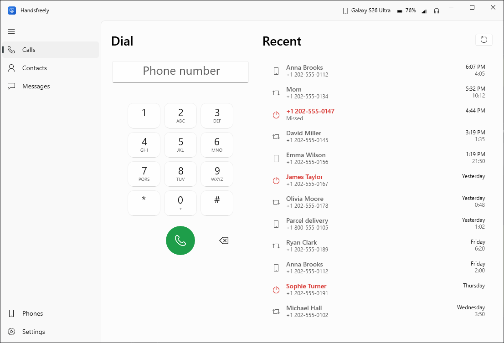
  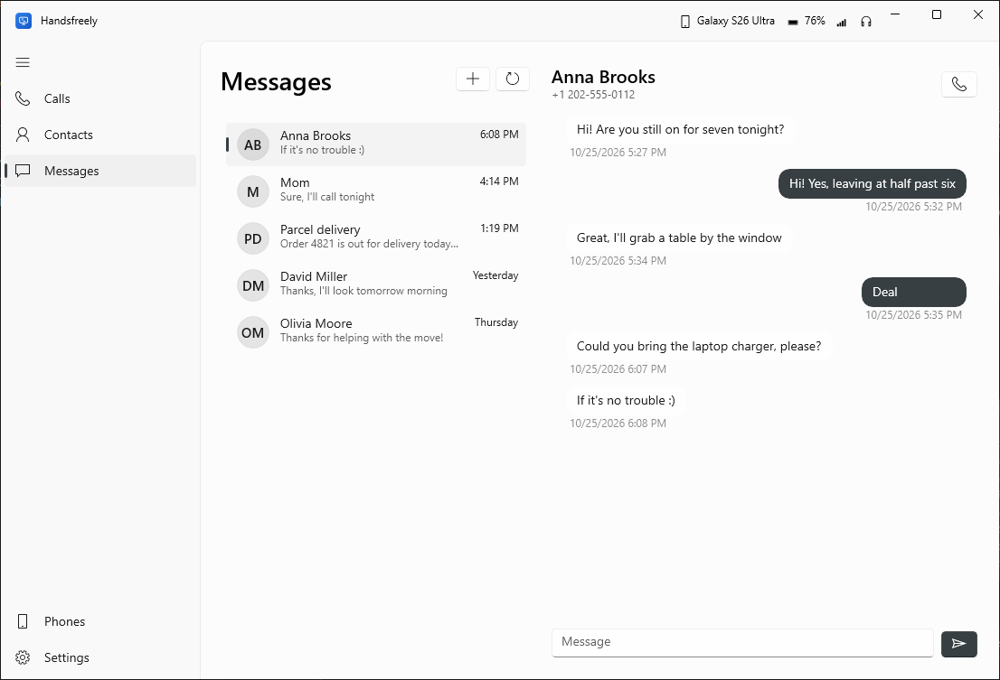
</p>
<p align="center">
  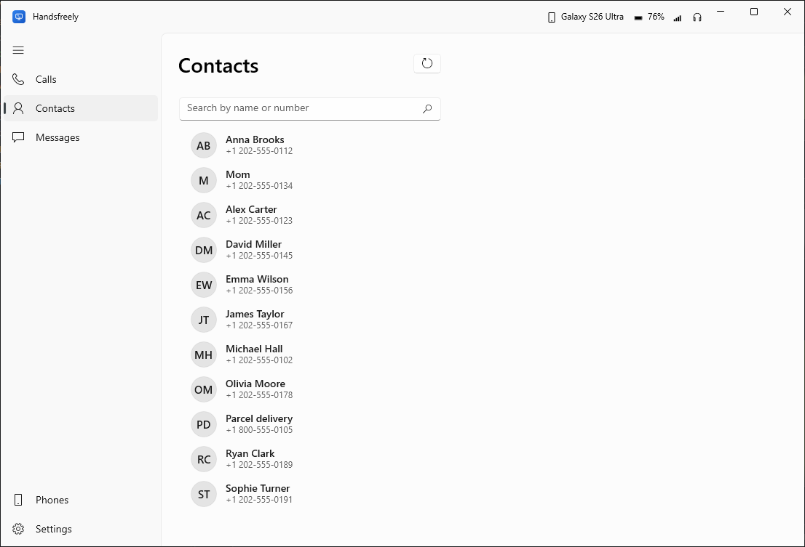
  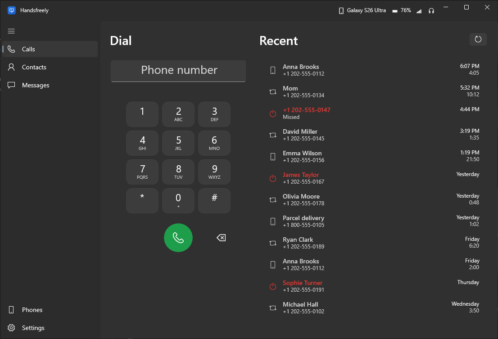
</p>

Phone:

<p align="center">
  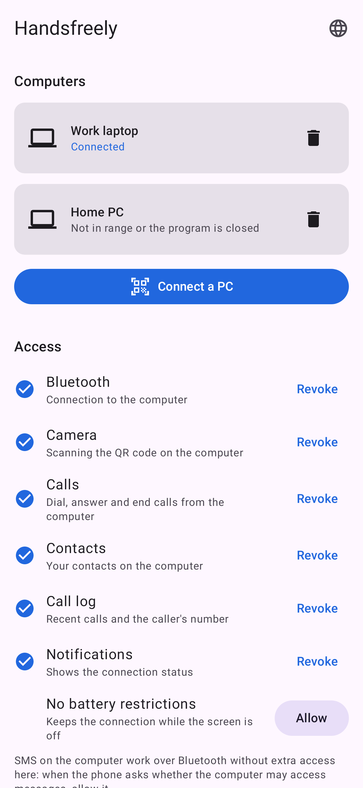
  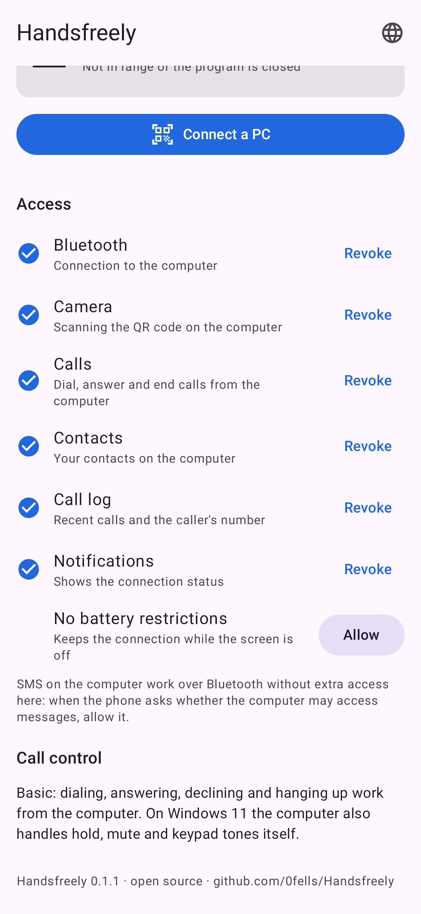
  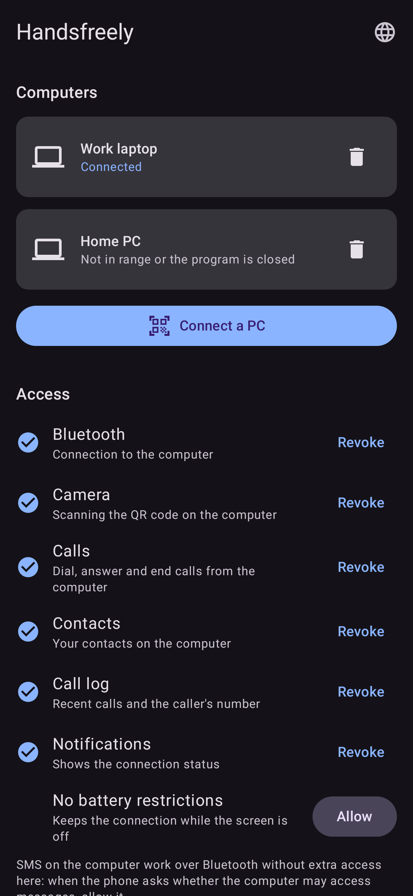
</p>

## Requirements

- Windows 10 version 2004 or later, or Windows 11, with Bluetooth.
- A phone with Android 10 or later.
- On Windows 10, hold, keypad tones and moving audio to the phone are not available from the computer: they need full call control in the phone app, and Android grants it only to system apps. On Windows 11, Windows handles these itself.

## Installation

The files are in the [latest release](https://github.com/0fells/Handsfreely/releases/latest).

**Computer.** The package is signed with the project's own certificate, so Windows has to trust it once:

1. Download `Handsfreely.cer` and `Handsfreely-x64.msix`.
2. Install the certificate in one of two ways:
   - Double-click `Handsfreely.cer` → "Install Certificate" → "Local Machine" → "Place all certificates in the following store" → "Browse" → "Trusted People" → "Finish".
   - Or open PowerShell as administrator and run (fix the path if the file is not in "Downloads"):
     ```
     Import-Certificate -FilePath "$env:USERPROFILE\Downloads\Handsfreely.cer" -CertStoreLocation Cert:\LocalMachine\TrustedPeople
     ```
3. Open `Handsfreely-x64.msix` and click "Install".

**Phone.** Download `Handsfreely.apk` to the phone, open it and allow installs from that source.

## Updating

Download the files of the new release and open them as during installation: `Handsfreely-x64.msix` on the computer (the "Update" button) and `Handsfreely.apk` on the phone. The new version installs over the old one, and pairing and settings are kept. The certificate does not need to be installed again.

## Uninstalling

- **Computer.** Start → right-click Handsfreely → "Uninstall" (or "Settings" → "Apps"). The program's settings and phone pairings are removed with it. The certificate stays; to remove it, run in PowerShell as administrator:
  ```
  Get-ChildItem Cert:\LocalMachine\TrustedPeople | Where-Object Subject -eq "CN=Handsfreely" | Remove-Item
  ```
  The Bluetooth pairing between the phone and the computer is removed separately, in Windows Bluetooth settings.
- **Phone.** Long-press the Handsfreely icon → "Uninstall" (or "Settings" → "Apps" → Handsfreely → "Uninstall"). All granted access goes away with the app.

## Getting connected

1. Pair the phone with the computer in Windows Bluetooth settings.
2. Install Handsfreely on the computer and on the phone (see "Installation").
3. On the computer, open "Phones" and click "Add a phone".
4. On the phone, tap "Connect a PC" and scan the QR code.
5. In the phone app, allow access to calls, contacts and the call log: whatever you don't allow won't show up on the PC. Any access can be revoked there as well.
6. When the phone asks whether the computer may access messages, allow it: this is how SMS work.

## How it works

Call audio uses the standard Bluetooth HFP profile: the computer becomes the phone's headset. The computer reads and sends SMS itself over the standard Bluetooth MAP profile. Contacts, the call log and call control travel over a separate RFCOMM channel between the PC program and the phone app. The channel is encrypted (ECDH P-256, AES-256-GCM), and the keys of both sides are pinned when the QR code is scanned. The protocol is described in [docs/protocol.en.md](docs/protocol.en.md).

## Building

Windows (needs the .NET 10 SDK):

```
dotnet test windows/Handsfreely.Core.Tests
dotnet build windows/Handsfreely.App -p:Platform=x64
```

`powershell -File tools/dev-run.ps1` builds, registers and starts a debug version (needs Windows Developer Mode). A debug version and a release version cannot coexist: before installing a release, remove the debug one (`Get-AppxPackage Handsfreely | Remove-AppxPackage -PreserveApplicationData` keeps pairing and settings), and before debugging, uninstall the installed one.

Android (needs JDK 17+ and Android SDK 35):

```
cd android
./gradlew testDebugUnitTest assembleDebug
```

Screenshots in `docs/screenshots` are rebuilt with made-up data: Windows - `powershell -File tools/screenshots.ps1` (the program runs in `--demo` mode), Android - `./gradlew testDebugUnitTest -Pscreenshots` (no phone needed, Robolectric).

Signed release files are built by `tools/make-release.ps1` into the `dist` folder. Signing keys live outside the repository: for MSIX in `%USERPROFILE%\.signing` (`handsfreely.pfx`, its password in `handsfreely-pfx.txt`, `Handsfreely.cer`), for APK in `~/.gradle/gradle.properties` (`handsfreelyKeystore`, `handsfreelyKeystorePassword`).

## License

[MIT](LICENSE). Third-party components are listed in [THIRD-PARTY-NOTICES.md](THIRD-PARTY-NOTICES.md).
